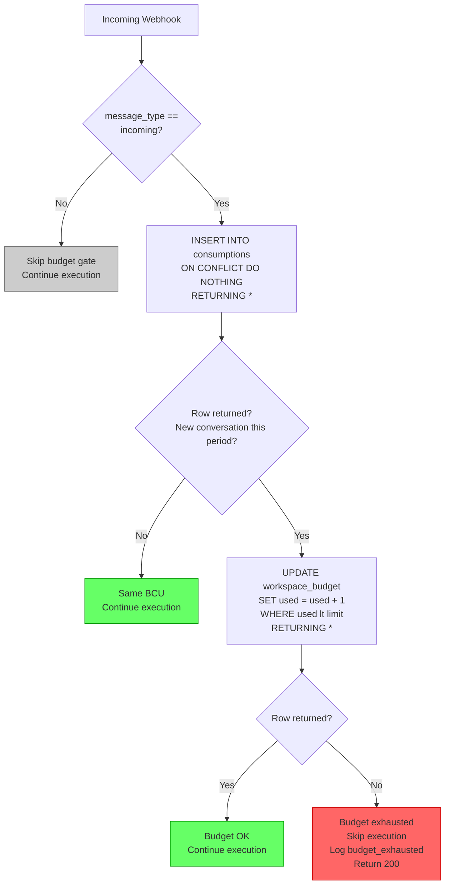
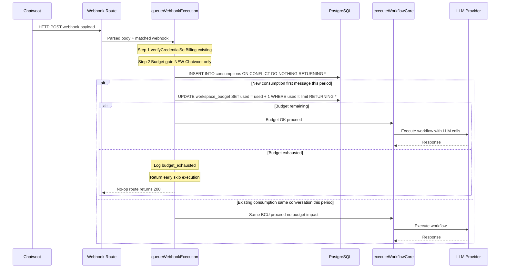
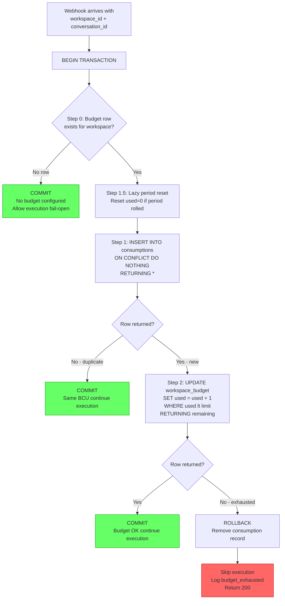
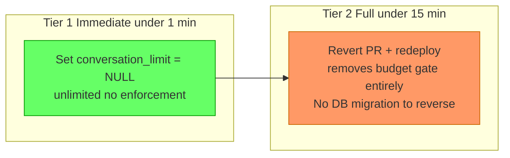

# Conversation Budget System — Architecture Document

> **Status:** Draft · **Author:** Architecture Team · **Last Updated:** 2025-07-15
>
> This document describes a **new** per-workspace conversation budget system for the Sim Studio + Chatwoot integration. No code exists yet — this is the authoritative design spec for implementation.

---

## Table of Contents

1. [Overview & Problem Statement](#1-overview--problem-statement)
2. [Budgeted Conversation Unit (BCU)](#2-budgeted-conversation-unit-bcu)
3. [Database Schema](#3-database-schema)
4. [Enforcement Pipeline](#4-enforcement-pipeline)
5. [Atomic Budget Check](#5-atomic-budget-check)
6. [Storage: PostgreSQL-Only](#6-storage-postgresql-only)
7. [Phase 1: Soft Limit](#7-phase-1-soft-limit)
8. [Phase 2: Hard Limit](#8-phase-2-hard-limit)
9. [Rollout Risk & Rollback](#9-rollout-risk--rollback)
10. [Appendix: Idempotency Bug Fix](#10-appendix-idempotency-bug-fix)
11. [Implementation: Drizzle ORM Schema](#11-implementation-drizzle-orm-schema)

---

## 1. Overview & Problem Statement

### Problem Statement

Sim Studio workflows triggered by Chatwoot webhooks incur real LLM costs (OpenAI, Anthropic, etc.) on every incoming message. Today there is **no mechanism** to cap or meter these costs at the workspace level. A single high-traffic client workspace can exhaust the operator's AI budget without warning.

> In this deployment, each workspace maps 1:1 to a Chatwoot client account managed by a single operator. The budget system lets the operator set monthly conversation caps per client to control AI provider costs.

### Current Gap

The existing execution pipeline processes webhooks through `queueWebhookExecution()` in `apps/sim/lib/webhooks/processor.ts`. There is no per-workspace conversation limit. This new conversation budget system is independent from existing upstream usage checks and scoped only to Chatwoot conversation volume per client workspace.

Every webhook execution flows directly to `executeWorkflowCore()` -> LLM calls -> cost accrual, with no per-workspace budget controls in the path.

### Key Design Principles

| Principle | Application |
|-----------|------------|
| **YAGNI** | PostgreSQL-only storage. No Redis, no queue, no distributed lock until volume proves necessary. |
| **Fail-Open** | If the budget system errors, execution proceeds (we lose metering, not service). Hard failures only after Phase 2 is battle-tested. |
| **Phased Rollout** | Phase 1 = soft limit (instrument, count, log, don't block) -> Phase 2 = hard enforcement. Each phase is independently deployable and reversible. |
| **KISS** | One enforcement point, one atomic DB operation, one rollback lever. |

---

## 2. Budgeted Conversation Unit (BCU)

A **Budgeted Conversation Unit (BCU)** is the atomic budget-tracking unit for the conversation budget system. It represents one unique AI-handled conversation within a monthly budget period.

BCU limits are operator-configured per workspace/client — they are not customer-facing billing quotas.

### Definition

| Property | Rule |
|----------|------|
| **Trigger** | First incoming message in a unique `(workspace_id, chatwoot_conversation_id)` pair within a given `period_key` |
| **Period** | Monthly. `period_key` = `'YYYY-MM'` (e.g. `'2026-02'`). |

> **Timezone:** All period calculations use UTC. `period_key` is generated as `new Date().toISOString().slice(0, 7)` (always UTC). All PostgreSQL `date_trunc` expressions use `AT TIME ZONE 'UTC'`.
| **Message type filter** | Only `message_type="incoming"` can start a BCU |
| **Human handoff** | Still counts — the bot performed work before handoff |
| **Webhook retries** | Do NOT create new BCUs — idempotency via `chatwoot_conversation_consumptions` PRIMARY KEY constraint |

### BCU Decision Flowchart



### BCU Edge Cases Matrix

| Edge Case | Behavior | Rationale |
|-----------|----------|-----------|
| Customer sends 50 messages in one conversation | 1 BCU | Same `(workspace_id, chatwoot_conversation_id, period_key)` — only the first message creates the BCU |
| Bot replies 10 times to customer | 0 BCU impact | `message_type="outgoing"` — outgoing messages never consume budget units |
| Chatwoot retries webhook 3 times | 1 BCU | `INSERT ON CONFLICT DO NOTHING` — idempotent by PRIMARY KEY |
| Human agent takes over mid-conversation | 1 BCU (already counted) | Bot performed work before handoff; the BCU was consumed on the first incoming message |
| Customer opens 3 separate conversations | 3 BCUs | Each `conversation_id` is a distinct budget unit |
| Outgoing campaign message (bot-initiated) | 0 BCUs | `message_type != "incoming"` — no BCU triggered |
| Webhook arrives with `message_type="activity"` | 0 BCUs | Only `"incoming"` triggers budget counting; activity/status messages are ignored |
| Period rolls over mid-conversation | New BCU in new period | Consumption record is keyed by `period_key`; same conversation in a new month gets a new BCU |

---

## 3. Database Schema

The budget system uses **2 tables**: a new `workspace_budget` table plus a new consumption tracking table. Each workspace maps 1:1 to a Chatwoot client. `workspace_id` is the sole client-workspace enforcement key in the budget tables.

### Table 1: `workspace_budget`

```sql
CREATE TABLE workspace_budget (
  workspace_id        TEXT PRIMARY KEY REFERENCES workspace(id) ON DELETE CASCADE,
  conversation_limit  INTEGER,                    -- NULL = unlimited
  conversation_used   INTEGER NOT NULL DEFAULT 0,
  period_start        TIMESTAMP NOT NULL DEFAULT date_trunc('month', NOW())
);
```

> **Why a separate table?** `workspace_budget` is an opt-in feature table rather than columns on `workspace`, following the existing pattern (`workspace_environment`, `workspace_byok_keys`). The feature can be dropped cleanly without impacting core workspace schema.

- `conversation_limit = NULL` means unlimited (no enforcement).
- `conversation_used` is atomically incremented via `UPDATE ... WHERE used < limit`.
- `period_start` is reset to `date_trunc('month', NOW())` at the start of each budget period. Monthly is hardcoded.

### Table 2: `chatwoot_conversation_consumptions`

Idempotent per-conversation-per-period record. The PRIMARY KEY includes `period_key` so that the same conversation can be counted in different months.

> **Critical:** Without `period_key` in the key, a February conversation could never be counted again in March's budget window — the old UNIQUE without `period_key` would permanently deduplicate a conversation across all months.

```sql
CREATE TABLE chatwoot_conversation_consumptions (
  workspace_id             TEXT NOT NULL REFERENCES workspace(id) ON DELETE CASCADE,
  chatwoot_conversation_id INTEGER NOT NULL,
  period_key               TEXT NOT NULL,           -- e.g. '2026-02'
  first_seen_at            TIMESTAMP NOT NULL DEFAULT NOW(),
  PRIMARY KEY (workspace_id, chatwoot_conversation_id, period_key)
);

CREATE INDEX idx_chatwoot_consumptions_workspace_period
  ON chatwoot_conversation_consumptions(workspace_id, period_key);
```

> **Drizzle ORM:** Define these tables as Drizzle schema objects in `packages/db/schema.ts`. Run `bun run db:generate` to generate the SQL migration, then `bun run db:migrate` to apply.

---

## 4. Enforcement Pipeline

### Current Pipeline (No Budget Gate)

```
Chatwoot -> POST /api/webhooks/trigger/[path]
  -> parseWebhookBody()
  -> findAllWebhooksForPath()
  -> verifyProviderAuth()
  -> queueWebhookExecution()
    -> verifyCredentialSetBilling()       <- existing upstream guard (independent of conversation budget)
    -> executeWorkflowCore()             <- LLM spend happens here
    -> DAGExecutor -> ExecutionEngine -> LLM calls
```

### Proposed Pipeline (With Budget Gate)

The budget gate is inserted **inside `queueWebhookExecution()` in `apps/sim/lib/webhooks/processor.ts`**, after the `workspaceId` null guard (line 1019–1021, after `verifyCredentialSetBilling`). This guarantees `foundWorkflow.workspaceId` is non-null when passed to `checkChatwootBudget()`. This follows the same guard-and-return pattern as the existing `verifyCredentialSetBilling` check, but is a separate, independent budget-cap gate.

This gate enforces operator-defined per-client limits to control AI provider spend; it does not perform customer billing.



### Insertion Code

> ⚠️ **Provider detection prerequisite:** Chatwoot webhooks currently arrive with `provider = 'generic'` (via the generic webhook trigger). Before the budget gate can use Option A, a dedicated Chatwoot trigger (`apps/sim/triggers/chatwoot/`) must be created to set `provider = 'chatwoot'`. Option B (body-sniffing) works immediately but is less explicit. Option A is the recommended long-term approach.

**Option A (Recommended) — Dedicated Chatwoot Trigger:**
```typescript
// Inside queueWebhookExecution(), after workspaceId null guard:
// Phase 1 prerequisite: create apps/sim/triggers/chatwoot/ trigger
// that sets provider = 'chatwoot' on the webhook record.
// Once done, the check becomes:
if (foundWebhook.provider === 'chatwoot') {
  const budgetResult = await checkChatwootBudget(body, foundWorkflow.workspaceId, options.requestId)
  if (!budgetResult.allowed) {
    logger.warn({ event: 'budget_exhausted', workspaceId: foundWorkflow.workspaceId })
    return // Return 200 — never send 4xx to Chatwoot
  }
}
```

**Option B (Body-sniffing fallback) — detect Chatwoot by payload shape:**
```typescript
// Inside queueWebhookExecution(), after workspaceId null guard:
const isChatwootWebhook = typeof body?.event === 'string' && body?.account?.id != null
if (isChatwootWebhook) {
  const budgetResult = await checkChatwootBudget(body, foundWorkflow.workspaceId, options.requestId)
  if (!budgetResult.allowed) {
    logger.warn({ event: 'budget_exhausted', workspaceId: foundWorkflow.workspaceId })
    return // Return 200 — never send 4xx to Chatwoot
  }
}
```

> **Never return 4xx to Chatwoot** — returning 402 or 429 triggers retry storms. The webhook route already returns 200 by default. When budget is exhausted, the function returns early with no HTTP error response. Chatwoot sees a successful 200 and does not retry.

### Why This Is the Correct Insertion Point

| Factor | Explanation |
|--------|-------------|
| **Cheapest** | Executes before any LLM spend — a single DB query costs ~1ms vs. $0.01-$0.10 per LLM call |
| **Mandatory** | All webhook-triggered executions pass through `queueWebhookExecution()` — no bypass possible |
| **Atomic** | PostgreSQL `INSERT ON CONFLICT` + `UPDATE ... WHERE used < limit` guarantees no double-counting under concurrency |
| **Consistent** | Follows the same guard-and-return pattern as the existing `verifyCredentialSetBilling` check in the same function |
| **Reversible** | Budget gate can be disabled per workspace by setting `conversation_limit = NULL` without touching any other code |

### Where It Lives in the Codebase

```
apps/sim/
|-- lib/
|   |-- webhooks/processor.ts                  <- queueWebhookExecution() — budget gate here
|   |-- execution/preprocessing.ts             <- existing preprocessExecution() for non-webhook
|   |-- execution/budget-gate.ts               <- NEW: checkChatwootBudget(), consumeConversation()
|   +-- workflows/executor/execution-core.ts   <- executeWorkflowCore() (unchanged)
```

---

## 5. Atomic Budget Check

The budget check runs as a single PostgreSQL transaction with four steps:

> **Timezone:** All period calculations use UTC. `period_key` is generated as `new Date().toISOString().slice(0, 7)` (always UTC). All PostgreSQL `date_trunc` expressions use `AT TIME ZONE 'UTC'`.

### Step 0: Fail-Open Pre-Check

```sql
-- Step 0: Check if workspace has budget configured
-- No row = no limit configured = allow execution (fail-open)
SELECT conversation_limit
FROM workspace_budget
WHERE workspace_id = $1;
-- If no row returned → skip entire budget gate, allow execution
```

If no row is returned, the workspace has no budget configured. The budget gate returns `{ allowed: true, reason: 'no_budget_configured' }` and execution proceeds with no metering.

### Step 1: Idempotent Consumption Insert

```sql
INSERT INTO chatwoot_conversation_consumptions
  (workspace_id, chatwoot_conversation_id, period_key)
VALUES
  ($1, $2, $3)
ON CONFLICT (workspace_id, chatwoot_conversation_id, period_key)
DO NOTHING
RETURNING *;
```

- If `RETURNING` yields a row -> new conversation this period, proceed to budget increment.
- If `RETURNING` yields nothing -> duplicate (same BCU), skip budget increment.

### Step 1.5: Lazy Period Reset

```sql
-- Step 1.5: Reset counter if period has rolled over (run inside transaction, before decrement)
UPDATE workspace_budget
SET conversation_used = 0,
    period_start = date_trunc('month', NOW() AT TIME ZONE 'UTC')
WHERE workspace_id = $1
  AND period_start < date_trunc('month', NOW() AT TIME ZONE 'UTC');
```

**Rationale:** This is a lazy reset — the counter resets atomically the first time the budget gate runs in a new month. No cron job needed. Runs inside the same transaction so it's atomic with the increment.

### Step 2: Atomic Budget Increment

```sql
UPDATE workspace_budget
SET conversation_used = conversation_used + 1
WHERE workspace_id = $1
  AND (conversation_limit IS NULL OR conversation_used < conversation_limit)
RETURNING COALESCE(conversation_limit - conversation_used, -1) AS remaining;
-- -1 signals unlimited; any value >= 0 means limited with N remaining
```

- If `RETURNING` yields a row -> budget incremented, `remaining` tells us how much is left (`-1` = unlimited).
- If `RETURNING` yields nothing -> budget exhausted, skip execution.

> **Note:** Exhaustion means the operator-configured monthly cap for that workspace/client has been reached.

Both queries run in a **single PostgreSQL transaction**, ensuring atomicity even under concurrent webhook delivery.

### Full Transaction Pseudocode (`budget-gate.ts`)

```typescript
// Full atomic budget check using Drizzle transaction
export async function checkChatwootBudget(
  body: unknown,
  workspaceId: string,
  requestId: string
): Promise<{ allowed: boolean; reason: string }> {
  try {
    return await db.transaction(async (tx) => {
      // Step 0: Fail-open if no budget row configured
      const budgetRows = await tx.select().from(workspaceBudget)
        .where(eq(workspaceBudget.workspaceId, workspaceId)).limit(1)
      if (budgetRows.length === 0) return { allowed: true, reason: 'no_budget_configured' }

      // Step 1.5: Lazy period reset
      await tx.execute(sql`
        UPDATE workspace_budget
        SET conversation_used = 0, period_start = date_trunc('month', NOW() AT TIME ZONE 'UTC')
        WHERE workspace_id = ${workspaceId}
          AND period_start < date_trunc('month', NOW() AT TIME ZONE 'UTC')
      `)

      // Step 1: Idempotent consumption insert
      const periodKey = new Date().toISOString().slice(0, 7) // 'YYYY-MM' (UTC)
      const conversationId = body?.conversation?.id
      if (!conversationId) return { allowed: true, reason: 'no_conversation_id' }

      const inserted = await tx.insert(chatwootConversationConsumptions)
        .values({ workspaceId, chatwootConversationId: conversationId, periodKey })
        .onConflictDoNothing()
        .returning()

      if (inserted.length === 0) return { allowed: true, reason: 'existing_bcu' }

      // Step 2: Atomic budget increment
      const updated = await tx.execute(sql`
        UPDATE workspace_budget
        SET conversation_used = conversation_used + 1
        WHERE workspace_id = ${workspaceId}
          AND (conversation_limit IS NULL OR conversation_used < conversation_limit)
        RETURNING COALESCE(conversation_limit - conversation_used, -1) AS remaining
      `)

      if (updated.rows.length === 0) return { allowed: false, reason: 'budget_exhausted' }
      return { allowed: true, reason: 'budget_ok' }
    })
  } catch (error) {
    logger.error({ event: 'budget_gate_error', workspaceId, error })
    return { allowed: true, reason: 'gate_error_fail_open' } // Fail-open
  }
}
```

### Atomic Budget Check Flow



---

## 6. Storage: PostgreSQL-Only

PostgreSQL-only. Add Redis read-cache only if Postgres budget check latency exceeds 10ms in production.

The storage pattern reuses the same approach as the existing `IdempotencyService` in `apps/sim/lib/core/idempotency/service.ts`: an `INSERT ON CONFLICT DO NOTHING` for idempotent record creation followed by a conditional `UPDATE` for the budget counter. Both run in a single transaction.

---

## 7. Phase 1: Soft Limit

**Goal:** Deploy schema, instrument the webhook pipeline, validate BCU counting accuracy, and fix the idempotency bug — all without impacting production traffic.

This phase merges initial instrumentation work (extracting `account_id` and `conversation_id` from webhook bodies, logging volumes, collecting baseline data) with the soft-limit counting logic.

| Task | Details |
|------|---------|
| Deploy schema | `CREATE TABLE workspace_budget` + `CREATE TABLE chatwoot_conversation_consumptions` (via Drizzle schema definitions + `bun run db:generate` + `bun run db:migrate`) |
| Fix Chatwoot idempotency bug | Add Chatwoot to `PROVIDER_EXTRACTORS` in `apps/sim/lib/webhooks/provider-utils.ts` (see Appendix) |
| Extract and log fields | Parse `conversation_id`, `message_type` from webhook body; log to execution metadata |
| Budget gate (soft mode) | Insert consumption records and update counters, but if budget exceeded log `budget_soft_blocked` and **continue execution** |
| Counting validation | Compare BCU counts to actual Chatwoot conversation counts — identify discrepancies |
| Baseline collection | Dashboard showing daily unique conversations per workspace/client, webhook volume histogram, message type distribution |

Limits are configured via DB seed or migration for MVP; Admin UI is explicitly out of scope for this self-hosted deployment. Limits are set directly in the database.

```sql
-- Seed budget rows for existing workspaces (run once during Phase 1 migration)
-- NULL limit = unlimited (tracking only, no enforcement)
INSERT INTO workspace_budget (workspace_id, conversation_limit, conversation_used, period_start)
SELECT id, NULL, 0, date_trunc('month', NOW() AT TIME ZONE 'UTC')
FROM workspace
ON CONFLICT DO NOTHING;
```

> **Note:** New workspaces automatically get fail-open behavior (no row = unlimited) — seeding is only needed if you want to set an explicit limit.

Budget events are logged using structured logger: `logger.warn({ event: 'budget_exhausted', workspace_id, used, limit })`.

**Success criteria for Phase 2 promotion:**
- BCU counts match Chatwoot conversation counts within +/-2% over 7 days
- Zero false positives (conversations that would have been incorrectly blocked)

---

## 8. Phase 2: Hard Limit

**Goal:** Enforce conversation budgets by blocking execution when budget is exhausted.

| Task | Details |
|------|---------|
| Hard enforcement | Budget gate skips execution — returns early with 200, logs `budget_exhausted` |
| Exhaustion behavior | Return HTTP 200 to Chatwoot. Skip `queueWebhookExecution()`. Log `budget_exhausted`. Human agents see the unanswered conversation naturally in Chatwoot. |
| Thresholds are data-driven | Use Phase 1 baseline data to set initial limits |
| Kill switches | Set `conversation_limit = NULL` for any workspace (instant, no redeploy needed) |
| Monitoring | Structured logging dashboards for budget exhaustion events, false positives, latency impact |

### Phase 2.5: Chatwoot API Graceful Handoff

**Removed from implementation scope.** When the budget is exhausted, human agents see unanswered conversations in their Chatwoot queue naturally — no programmatic notification is needed. This enhancement may be revisited if clients report confusion about unanswered messages.

---

## 9. Rollout Risk & Rollback

### Risk Matrix

| Risk | Likelihood | Impact | Mitigation | Residual Risk |
|------|-----------|--------|------------|---------------|
| **Race condition (double-count)** | Medium | Medium — overcount BCUs, premature budget exhaustion | PG `INSERT ON CONFLICT DO NOTHING` is atomic; single transaction for insert + increment | Low — PG guarantees serialized conflict resolution |
| **False positive blocking** | Medium | High — legitimate conversations rejected | Phase 1 soft-limit validates counting; `message_type` filter prevents outgoing/activity msgs from triggering BCU | Low after Phase 1 validation |
| **Outgoing messages double-counted** | High (without filter) | Medium — budget consumed 2x faster than expected | Strict `message_type == "incoming"` filter at BCU decision point | None — filter is deterministic |
| **Counter reset failure** | Low | Medium — budget never resets, accumulates forever | Automatic reset when `period_start` is before current month; manual `UPDATE` as fallback | Low |
| **Code crash in budget gate** | Low | High — all webhook executions fail | `try/catch` wrapper with fail-open behavior; crash logs `budget_gate_error` event and proceeds | Low — fail-open ensures service continuity |
| **Period boundary edge case** | Low | Low — conversation counted in wrong period | Use `period_key` (e.g. `'2026-02'`) in consumption record; period rolls at UTC midnight | None |
| **Multi-instance race on budget increment** | Medium | Medium — two instances both increment, overshoot by 1 | PG `UPDATE ... WHERE used < limit` is atomic across connections; PostgreSQL's READ COMMITTED isolation re-evaluates the UPDATE WHERE clause after row-level lock acquisition | Very Low — overshoot = 0: the second concurrent UPDATE sees the already-incremented value and fails the WHERE condition if at limit |

### Rollback Tiers



| Tier | Action | Time | Data Impact | When to Use |
|------|--------|------|------------|-------------|
| **Tier 1 — Immediate** | Set `conversation_limit = NULL` for affected workspaces/clients | under 1 min | None — NULL means unlimited | False positives detected; specific or all client workspaces impacted |
| **Tier 2 — Full** | Revert the PR, redeploy | under 15 min | None in Phase 1 (no blocking); Phase 2 may need consumption table cleanup | Critical bug; system fundamentally broken |

---

## 10. Appendix: Idempotency Bug Fix

> **Fix this in Phase 1 alongside schema deployment.** The consumption table's PRIMARY KEY constraint provides a second layer of BCU protection, but the idempotency bug causes real duplicate LLM spend from Chatwoot retries.

### Current Behavior (Broken)

The existing webhook idempotency system in `apps/sim/lib/core/idempotency/service.ts` uses `createWebhookIdempotencyKey()` to extract provider-specific deduplication keys from headers. However, Chatwoot webhooks do not include any standard idempotency headers (`Idempotency-Key`, `X-Request-Id`, etc.).

When no provider-specific key is found, the system falls through to the **generic provider** handler, which generates a `randomUUID()` as the idempotency key:

```
Chatwoot webhook -> createWebhookIdempotencyKey()
  -> No matching provider extractor
  -> Falls through to generic: randomUUID()
  -> Every retry gets a UNIQUE key
  -> Idempotency is DEFEATED
```

### Impact

| Scenario | Current Behavior | Correct Behavior |
|----------|-----------------|------------------|
| Chatwoot retries webhook (network timeout) | Creates a **new** execution with new UUID key | Should deduplicate — same `body.id` means same message |
| Chatwoot sends duplicate webhook (bug) | Creates a **new** execution | Should deduplicate |
| Budget system counts BCUs | Each retry = **phantom BCU** | Retries should be free (same conversation) |

### Fix

Add a **Chatwoot provider extractor** to `PROVIDER_EXTRACTORS` in `apps/sim/lib/webhooks/provider-utils.ts` using key `chatwoot:{account_id}:{message_id}` = `body.account.id + ':' + body.id`:

```
Chatwoot webhook -> createWebhookIdempotencyKey()
  -> Detect Chatwoot provider (body.event exists, body.account exists)
  -> Extract body.id as idempotency key
  -> Format: "chatwoot:{account_id}:{message_id}"
  -> Retries hit same key -> deduplicated
```

**Key format:** `chatwoot:{body.account.id}:{body.id}`

This ensures that:
1. Retries for the same Chatwoot message are deduplicated
2. Different messages from the same account are distinct
3. Messages across accounts never collide

### Dependency

The consumption table's PRIMARY KEY on `(workspace_id, chatwoot_conversation_id, period_key)` provides a **second layer** of idempotency for budget counting, but the idempotency fix is still needed to prevent phantom **executions** (which cost LLM money even if budget counting is correct).

---

## 11. Implementation: Drizzle ORM Schema

This project uses **Drizzle ORM** for all database schema management. All new tables must be defined as Drizzle schema objects — do NOT run raw SQL migrations manually.

### Schema file
`packages/db/schema.ts`

Add the two new table definitions:

```typescript
// Add primaryKey to existing drizzle-orm/pg-core import in packages/db/schema.ts:
// import { ..., primaryKey } from 'drizzle-orm/pg-core'
// Note: this is the first composite PK in the schema
```

```typescript
export const workspaceBudget = pgTable('workspace_budget', {
  workspaceId: text('workspace_id').primaryKey().references(() => workspace.id, { onDelete: 'cascade' }),
  conversationLimit: integer('conversation_limit'),
  conversationUsed: integer('conversation_used').notNull().default(0),
  periodStart: timestamp('period_start').notNull().defaultNow(),
})

export const chatwootConversationConsumptions = pgTable(
  'chatwoot_conversation_consumptions',
  {
    workspaceId: text('workspace_id').notNull().references(() => workspace.id, { onDelete: 'cascade' }),
    chatwootConversationId: integer('chatwoot_conversation_id').notNull(),
    periodKey: text('period_key').notNull(),
    firstSeenAt: timestamp('first_seen_at').notNull().defaultNow(),
  },
  (t) => ({
    pk: primaryKey({ columns: [t.workspaceId, t.chatwootConversationId, t.periodKey] }),
    workspacePeriodIdx: index('idx_chatwoot_consumptions_workspace_period').on(t.workspaceId, t.periodKey),
  })
)
```

### Migration commands
```bash
bun run db:generate   # Generate SQL migration from schema diff
bun run db:migrate    # Apply pending migrations to database
```

---

## Appendix: Glossary

| Term | Definition |
|------|-----------|
| **BCU** | Budgeted Conversation Unit — the atomic unit used to track monthly conversation budget usage per client workspace |
| **Budget Gate** | The check inside `queueWebhookExecution()` that enforces conversation budgets |
| **Consumption Record** | A row in `chatwoot_conversation_consumptions` representing one BCU |
| **Fail-Open** | Design pattern where system errors result in allowing execution (not blocking) |
| **Period Key** | A string like `'2026-02'` representing the monthly budget period for grouping consumptions |
| **Soft Limit** | Phase 1 behavior — log budget violations but do not block execution |
| **Hard Limit** | Phase 2 behavior — skip execution when budget is exhausted |
| **Kill Switch** | Set `conversation_limit = NULL` on workspace to instantly disable budget enforcement for that workspace |
| **Client Workspace** | A Sim workspace corresponding to one Chatwoot account/business managed by the operator |

## Appendix: Related Files

| File | Role |
|------|------|
| `apps/sim/lib/webhooks/processor.ts` | `queueWebhookExecution()` — budget gate insertion point |
| `apps/sim/lib/webhooks/provider-utils.ts` | `PROVIDER_EXTRACTORS` — add Chatwoot idempotency key |
| `apps/sim/lib/execution/preprocessing.ts` | Existing `preprocessExecution()` for non-webhook triggers |
| `apps/sim/lib/core/idempotency/service.ts` | Existing idempotency service |
| `apps/sim/lib/billing/calculations/usage-monitor.ts` | Pre-existing upstream usage-limit module — NOT a dependency of this conversation budget system |
| `apps/sim/lib/execution/budget-gate.ts` | **NEW** — `checkChatwootBudget()`, `consumeConversation()` |
| `packages/db/schema.ts` | Drizzle schema definitions (add `workspace_budget` and `chatwoot_conversation_consumptions` tables here) |
| `packages/db/migrations/` | Generated SQL migration files |
